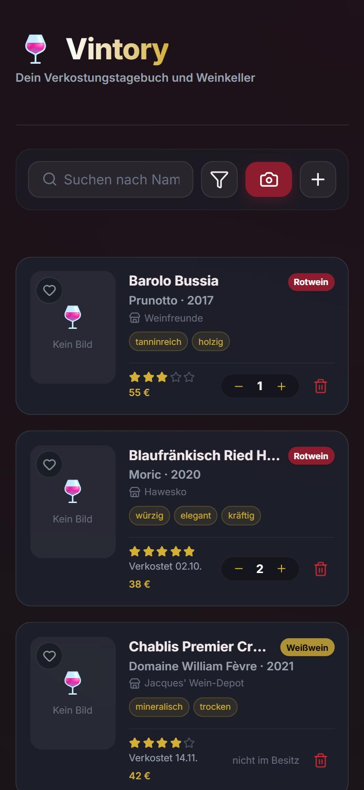
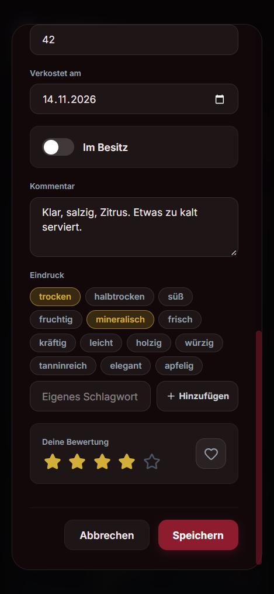
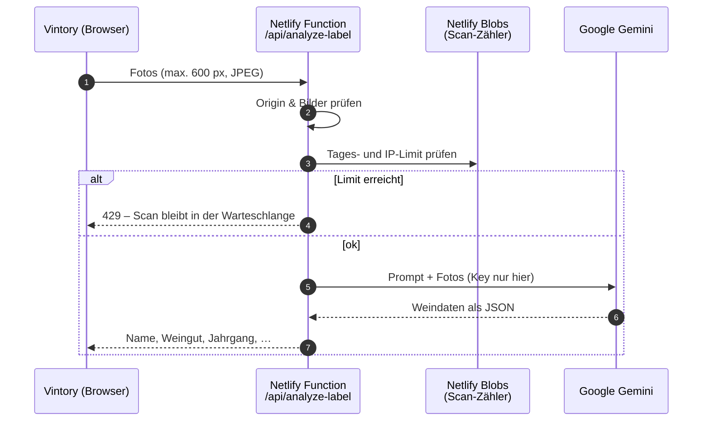

<div align="center">


# Vintory

**Dein Verkostungstagebuch und Weinkeller – mit KI-Etikettenscan.**

Etikett fotografieren, die KI füllt Name, Weingut, Jahrgang & Co. aus, du ergänzt Händler, Eindruck und Bewertung.
Alles bleibt auf deinem Gerät.

[](https://app.netlify.com/projects/vintory/deploys)


**[➜ vintory.netlify.app öffnen](https://vintory.netlify.app)**

</div>

---

<table>
  <tr>
    <td align="center" width="50%"><br /><sub>Weinliste: Händler, Eindruck, Bewertung, Besitz</sub></td>
    <td align="center" width="50%"><br /><sub>Erfassen: Verkostet am, Kommentar, Schlagwörter</sub></td>
  </tr>
</table>

## Was Vintory kann

| | |
|---|---|
| 📸 **Etikett scannen** | Vorder- und optional Rückseite fotografieren – die KI erkennt Name, Weingut, Jahrgang, Region, Rebsorte und schätzt den Preis. |
| 📝 **Verkostungstagebuch** | Verkostet am, Kommentar, Bewertung, Favorit und Schlagwörter für den Eindruck (*mineralisch, fruchtig, …* oder eigene). |
| 🏪 **Händler** | Wo gekauft oder probiert – mit Vorschlägen aus deinen bisherigen Händlern. |
| 🍾 **Weinkeller** | „Im Besitz“ per Schalter, Flaschenanzahl mit +/−, Wert deiner Flaschen in der Statistik. |
| 🔍 **Suchen & Filtern** | Volltextsuche (auch in Kommentaren), Filter nach Weintyp, Besitz, Händler und Schlagwörtern, Sortierung u. a. nach „Zuletzt verkostet“. |
| ♻️ **Duplikate erkennen** | Scannst du einen Wein erneut, zeigt Vintory deinen alten Eintrag samt Kommentar. |
| 📴 **Offline** | Installierbar als App; Scans ohne Netz landen in einer Warteschlange und werden später ausgewertet. |
| 💾 **Backup** | Export als Datei, Import mit Wahl zwischen *Zusammenführen* und *Ersetzen*. |

## Deine Daten

- **Bleiben auf deinem Gerät** – in der Browser-Datenbank (IndexedDB). Kein Konto, kein Server, keine Cloud-Kopie.
- **Gehen nicht verloren**: Updates verändern keine bestehenden Einträge; Löschen und Ersetzen fragen nach bzw. legen vorher automatisch ein Backup an ([ADR 0003](docs/adr/0003-nutzerdaten-nur-lokal.md)).
- **Nur zum Scannen** werden die Etikettenfotos an Google Gemini geschickt – über einen eigenen Server-Proxy, der API-Key ist nie im Browser.
- **Sichere regelmäßig ein Backup** (Export unten auf der Seite) – wer die Browserdaten löscht, löscht auch die Weinliste.

## So funktioniert der Scan



Scans sind begrenzt (standardmäßig 200 pro Tag, 30 pro Stunde und IP), damit die KI-Kosten gedeckelt bleiben – Details in [ADR 0002](docs/adr/0002-scan-limits-fail-closed.md).

### Welches KI-Modell?

Standard ist **`gemini-3.5-flash-lite`**. Im Vergleich mit fünf echten Etikettenfotos (Mosel, Saar, Bordeaux, Rioja, Burgund; teils mit Rückseite) haben alle getesteten Modelle Weingut, Jahrgang, Typ, Region und Rebsorte korrekt erkannt – die Lite-Modelle aber deutlich schneller und günstiger:

| Modell | Antwortzeit | Kosten pro Scan |
|---|---|---|
| `gemini-3.8-flash` | ~5 s | ~0,30 ct (ab 2027 doppelt) |
| **`gemini-3.5-flash-lite`** | **~1 s** | **~0,08 ct** |
| `gemini-3.1-flash-lite` | ~1 s | ~0,06 ct |

<sub>Stand 21.11.2026. Die Preisschätzung der KI ist bei allen Modellen nur eine grobe Orientierung.</sub>

## Entwickeln

**Voraussetzungen:** Node 22, [Netlify CLI](https://docs.netlify.com/api-and-cli-guides/cli-guides/get-started-with-cli/) (`npm install -g netlify-cli`)

```bash
npm install
netlify link       # einmalig: mit dem Netlify-Projekt verknüpfen
netlify dev        # App + Scan-Function auf http://localhost:8888
```

`npm run dev` startet nur das Frontend (ohne Scan). Weitere Skripte: `npm run build`, `npm run lint`.

### Umgebungsvariablen (Netlify)

| Variable | Pflicht | Bedeutung |
|---|---|---|
| `GEMINI_API_KEY` | ✅ | Gemini-API-Key, nur für die Function. **Niemals mit `VITE_` beginnen** – das landet im öffentlichen Bundle. |
| `GEMINI_MODEL` | | Modell, Standard `gemini-3.5-flash-lite` (schnell, günstig; Vergleich siehe unten) |
| `SCAN_LIMIT_PER_DAY` | | Scans pro Tag für alle zusammen, Standard 200 |
| `SCAN_LIMIT_PER_IP_HOUR` | | Scans pro Stunde je IP, Standard 30 |

Änderungen an Variablen wirken erst nach einem neuen Deploy. Lokal: `.env` nach Vorlage von [`.env.example`](.env.example).

### Deploy

Jeder Push auf `master` wird von Netlify automatisch gebaut und veröffentlicht. Vorschau ohne Live-Gang:

```bash
npm run build
netlify deploy --dir dist --functions netlify/functions
```

## Aufbau

```
src/
├── core/
│   ├── entities/        Wine, ScanQueueItem
│   ├── repositories/    Repository-Interface
│   └── services/        Gemini-Client, Backup-Import
├── infrastructure/db/   IndexedDB-Repository
└── ui/
    ├── context/         State, Warteschlange, Import/Export
    ├── components/      Weinkarte, Dialoge (Erfassen, Scanner, Filter, Import, Händler)
    └── hooks/           Kamera
netlify/functions/       Server-Proxy für Gemini inkl. Scan-Limits
docs/adr/                Architektur-Entscheidungen
```

**Stack:** React 18 · TypeScript · Vite 5 · Tailwind CSS 4 · vite-plugin-pwa · Netlify Functions & Blobs · Google Gemini

## Mitdenken

- **[CONTEXT.md](CONTEXT.md)** – die Fachbegriffe (Wein, Weingut vs. Händler, Im Besitz, Scan, …). Bitte im Code und in Texten genau diese Wörter verwenden.
- **[docs/adr/](docs/adr/)** – warum Dinge so sind, wie sie sind:
  [Server-Proxy](docs/adr/0001-gemini-nur-ueber-server-proxy.md) ·
  [Scan-Limits](docs/adr/0002-scan-limits-fail-closed.md) ·
  [Daten nur lokal](docs/adr/0003-nutzerdaten-nur-lokal.md) ·
  [Im Besitz](docs/adr/0004-im-besitz-aus-anzahl-abgeleitet.md) ·
  [Ein Eintrag pro Wein](docs/adr/0005-ein-eintrag-pro-wein.md)
